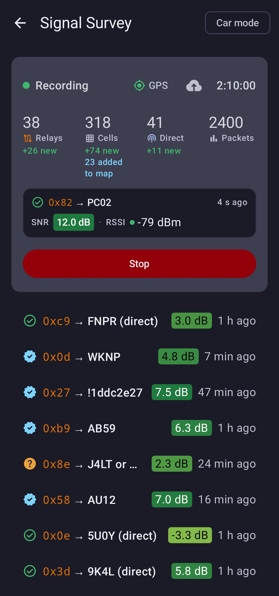
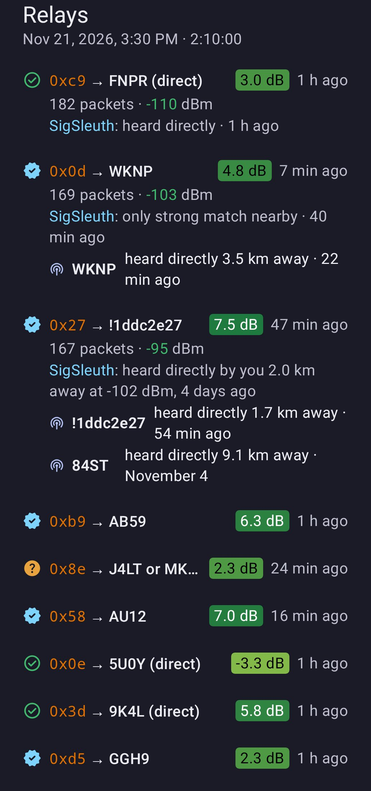

# Mesh Survey

Mesh Survey is a modified fork of [Meshtastic-Android](https://github.com/meshtastic/Meshtastic-Android) that works with Meshtastic® nodes. It adds a **signal survey**: while a survey runs, the app records every LoRa packet the connected node hears, with the phone's GPS position, and can export each session as CSV or upload it to a [SigSleuth](https://github.com/joroses/sigsleuth) server. See [`feature/survey/README.md`](feature/survey/README.md) for how it works and which upstream files it changes.

<p align="center">
  
  
</p>

- **Modified work.** This fork has been modified from the upstream project since 2026-09: the signal survey, the app name, application ID and icons, and the source link on the About screen. The [commit history](https://github.com/joroses/mesh-survey/commits/feature/signal-survey) shows every change and its date.
- **Not affiliated.** Mesh Survey is not affiliated with, sponsored by or endorsed by Meshtastic LLC or the Meshtastic project. Please report problems with this fork [here](https://github.com/joroses/mesh-survey/issues), not to the Meshtastic project.
- **Trademark.** Meshtastic® is a registered trademark of Meshtastic LLC.
- **License.** Like the upstream project, this fork is licensed under the [GNU General Public License v3.0 or later](LICENSE). The source of every release is the tagged commit it was built from.

## Privacy

A signal survey is a record of where you were and when. Read this before you start one.

**What is recorded.** Nothing is recorded until you start a survey: Start in Settings → Advanced → Signal Survey, or the Signal Survey tile in Quick Settings, which opens that screen and starts it. While a survey runs, the app reads the phone's GPS once a second and, for every LoRa packet your node hears, saves a row in a database on the phone. Each row holds:

- the time to the millisecond
- your position: latitude, longitude, the fix's accuracy and age
- the signal: SNR, RSSI, hop counts and relay byte
- the sender's OK to MQTT bit and whether the channel uses the default key, when the node could decode the packet
- the packet's sender node, recipient node and packet ID. These are other people's node numbers.

Each session also saves your node's number and long name, and the radio settings. A busy mesh can produce several rows a second, so a session is a detailed track of your movements. A quiet mesh may produce none for minutes. Packets relayed over MQTT and packets from your own node are not recorded, and the app records nothing while the radio is disconnected.

**Where it goes.** The rows stay on the phone until you delete a session.

- **Upload:** only to a server whose address you enter yourself. Uploading is off until you enter one. Once you do, "Upload automatically" is on by default: each new session goes to that server every minute while you record, and again when it ends. Turn it off before or during a session to keep that session on the phone; you can still upload it later with its Upload button. Nothing recorded with it off is sent unless you tap Upload. Uploads go over HTTPS, with the password in a header, never in the address.
- **CSV export:** goes wherever you choose to share the file.
- **Relay list download:** with a server address entered, a recording session downloads that server's list of nodes that could have relayed your packets, at most once a day, so relay guesses work offline. The request carries only your radio settings (spreading factor, bandwidth and frequency) and the password, never your position.

The app has no server of its own: neither the author of this fork nor the Meshtastic project receives any survey data.

**The rest of the app** behaves like the upstream `fdroid` build. There is no analytics or crash reporting. It talks to your radio, to Meshtastic's servers (for example for firmware and device lists) and to the map tile providers you use, and to MQTT only if you enable it.

**If you run a server that others upload to,** you are collecting their location history. Tell them what you keep, for how long and who can see it. Where the GDPR applies, you need a lawful basis and a privacy notice of your own.

## Install

Mesh Survey isn't on Google Play or F-Droid. Download an APK from [Releases](https://github.com/joroses/mesh-survey/releases):

- **`arm64-v8a`:** almost every phone from the last several years.
- **`armeabi-v7a`:** older or low-end phones with a 32-bit processor.
- **`universal`:** if you're not sure. It's bigger, but runs on any phone.

It installs as its own app, next to the official Meshtastic app, and doesn't touch its data. It needs Android 8.0 or newer.

### On the phone

1. Open the downloaded APK, from the browser's downloads or a file manager.
2. Android asks you to allow that app to install apps. Tap **Settings**, turn on **Allow from this source**, and go back. The setting is called "Install unknown apps", under Settings → Apps → Special app access. You can turn it off again after installing.
3. Tap **Install**. Google Play Protect may warn that it doesn't recognise the app, because it isn't from Play. Tap **More details → Install anyway**.

### With ADB from a computer

1. Turn on **Developer options**: tap **Build number** in Settings → About phone seven times.
2. In Developer options, turn on **USB debugging**.
3. Connect the phone, accept the prompt on its screen, and run:
   ```bash
   adb install androidApp-fdroid-arm64-v8a-release.apk
   ```

### Check the APK (optional)

Releases from this repository are signed with a certificate whose SHA-256 is `9D:FC:DF:B6:38:50:56:A8:99:E1:FF:5D:4A:B5:F0:0F:B3:B0:D8:51:8D:4F:C0:10:1E:28:BD:AE:F2:14:84:94`. Compare it with what [AppVerifier](https://github.com/soupslurpr/AppVerifier) shows on the phone, or `apksigner verify --print-certs` on a computer. If it doesn't match, don't install the APK.

### Updates

Install the newer APK over the old one, the same way: your sessions and settings stay. To be notified of new versions, add `https://github.com/joroses/mesh-survey` to [Obtainium](https://github.com/ImranR98/Obtainium). Android won't install an older version over a newer one, or an APK signed with a different key. Uninstalling deletes every survey session on the phone, so export or upload them first.

### Before a long survey

- Allow **precise** location. With approximate location only, a survey won't start.
- Allow notifications, so the survey's ongoing notification and its Stop button show.
- Phones that kill background apps can stop a survey while the screen is off. Under Settings → Apps → Mesh Survey → Battery, choose **Unrestricted**.
- Leaving the survey running for a long time can drain your battery quite fast. Remember to stop it!

## Upstream

Everything outside the signal survey comes from [Meshtastic-Android](https://github.com/meshtastic/Meshtastic-Android). Its [README](https://github.com/meshtastic/Meshtastic-Android#readme) covers the official app, its architecture and how to build it; each module here keeps its own README. To build this fork, see [`feature/survey/README.md`](feature/survey/README.md#build-and-try).

Copyright 2025-2026, Meshtastic LLC. GPL-3.0 license
